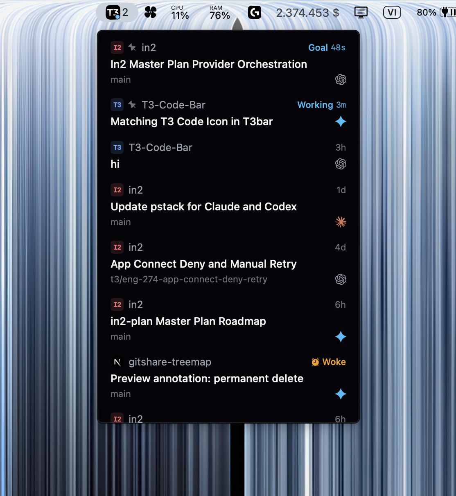

# T3 Code Bar

Keep your [T3 Code](https://github.com/pingdotgg/t3code) inbox in the macOS menu bar. Check running threads, spot requests that need your attention, and jump back into a conversation with one click.

Built with SwiftUI. An independent companion app, not affiliated with or endorsed by T3 Tools.



*Some status labels in the screenshot may differ from the current version.*

## Features

- View your local T3 Code inbox without switching windows.
- See Working, Approval, Input, Failed, and other thread states.
- Identify unread completions with **Done**; read threads show a relative timestamp.
- Keep pinned threads and manual inbox ordering.
- Bring snoozed threads back when an approval, input request, fresh session error, or new completion needs attention.
- Open threads in T3 Code or your browser, or copy their links.
- Read local data without modifying T3 Code's database.

## Requirements

- **macOS 14 or later.**
- **Git and Swift 6.0 or later**, available through a compatible Xcode or Xcode Command Line Tools installation.
- **T3 Code installed and opened at least once**, with a compatible local database.

**Apple Silicon (`arm64`) is the tested architecture.** Intel (`x86_64`) is untested. Builds target your local toolchain's architecture; the scripts do not create a universal binary.

T3 Code Bar reads T3 Code's internal projection-v2 schema, which can change between versions. The local version checked was `0.1.7-nightly.20261104.4151`. See [compatibility notes](docs/COMPATIBILITY.md) for details; compatibility with every T3 Code version is not guaranteed.

## Install

Run this in Terminal from a directory that does not already contain `t3code-bar`:

```bash
git clone https://github.com/eliophan/t3code-bar.git && bash t3code-bar/scripts/install.sh
```

The command downloads the source, builds a Release version on your Mac, installs it at `~/Applications/T3 Code Bar.app`, and opens it. No `sudo` is needed.

If you already downloaded or cloned the source, run this from the project directory instead:

```bash
bash scripts/install.sh
```

The installer stops if an app already exists at the destination. To reinstall, quit the app and move the old copy aside first. There is no automatic updater. After installation, you can remove the source directory; keep the installed app in `~/Applications`.

**Distribution status:** installation currently builds from source. No prebuilt `.app` download is provided. The checked local binary is **linker-signed ad hoc**, has **no Developer ID signature**, and **has not been notarized**. The scripts do not perform Developer ID signing or notarization.

## Usage

1. Open T3 Code, then launch T3 Code Bar.
2. Click the menu bar icon to view your inbox.
3. Click a thread to open it in T3 Code. Right-click a thread for **Open in T3 Code**, **Open in Browser**, or **Copy Link**.
4. To quit, right-click the menu bar icon and choose **Quit T3 Code Bar**.

The app has no Dock icon. To launch it at login, add `~/Applications/T3 Code Bar.app` under **System Settings → General → Login Items → Open at Login**.

Browser links use `127.0.0.1` and the port configured by your local T3 Code instance. Your browser session may need sign-in or pairing. Opening links in T3 Code requires its `t3code://` URL scheme to be registered.

### Thread states

| State | Meaning |
| --- | --- |
| Approval / Input | The thread is waiting for you to approve an action or answer a question. |
| Connecting / Working / Goal | The saved run state indicates startup or work in progress. |
| Failed | The latest visible run failed. |
| Woke | A snoozed thread has woken and its wake timestamp is newer than the persisted last visit, or no valid visit is available. |
| Plan Ready | A proposed plan is ready in plan mode. |
| Done | The latest visible run completed after the last valid visit saved by T3 Code. |
| Relative time | No higher-priority status applies; the row shows time based on the latest user message. |

Done clears when T3 Code saves a newer visit timestamp. If no valid visit timestamp is available, the app shows time rather than assuming a completion is unread. Clicking a link in Bar does not itself mark a thread as read.

Archived, deleted, and settled threads, side chats, and separate subagent threads are excluded. Snoozed threads stay hidden until the timer expires or a new attention event wakes them. An error or completion that already existed when the thread was snoozed does not wake it early.

## Privacy

T3 Code Bar reads local data and does not require an API key.

- Opens T3 Code's SQLite database in **read-only** mode to read thread, project, run, request, and visit metadata.
- Reads `server-runtime.json` and `environment-id` to identify the local instance and construct links.
- May read project favicon/logo files from local workspace paths.
- Does not modify or migrate the database, answer approvals, or send messages on your behalf.
- Does not collect telemetry, access provider credential stores, or call AI services.

When you open a thread, macOS hands the URL to T3 Code or your browser. That application handles its own connections and authentication. When sharing screenshots or bug reports, check for private thread names, project names, and paths.

## Configuration

By default, the app reads `~/.t3/userdata`. Override it using one of these environment variables, in priority order:

| Variable | Expected directory |
| --- | --- |
| `T3_CODE_BAR_STATE_DIR` | Contains `statev2.sqlite`, `server-runtime.json`, and `environment-id` directly. |
| `T3CODE_HOME` | T3 Code's root directory; Bar appends `/userdata`. |

For example, from the source directory:

```bash
T3CODE_HOME="$HOME/.t3-custom" swift run T3CodeBar
```

Apps opened from Finder or Login Items do not automatically inherit your terminal's environment. For custom data directories, launch from Terminal or configure a launcher that passes these variables.

## Troubleshooting

| Problem | What to check |
| --- | --- |
| Data not found | Open T3 Code at least once and check the configured data directory. |
| Unsupported schema | Your T3 Code version may use a different database structure. See the compatibility notes. Bar does not repair the database. |
| Offline | Reopen T3 Code. Saved threads remain visible, but live activity indicators are disabled. |
| Busy/read error | The app retries every second. Use **Retry** to retry immediately when no read is in progress. |
| Links do not open | Check the T3 Code installation, URL scheme registration, and local runtime configuration. |
| Installation fails | Check `swift --version` for Swift 6 or later and read the Terminal error. If the destination app already exists, quit it and move it aside. |

For a bug report, [open an issue](https://github.com/eliophan/t3code-bar/issues) with your macOS version, architecture, T3 Code version, and steps to reproduce. Redact private information; do not attach your database or credentials.

## Known limitations

- Monitors one local T3 Code instance, not remote machines.
- Some background activity exists only in T3 Code's memory and cannot be inferred from SQLite. Working/Monitoring indicators after the main run ends may be incomplete.
- Unread completion and wake indicators depend on visit timestamps persisted by T3 Code; Bar does not read browser localStorage or call the sidebar's acknowledgment API.
- Server availability uses the runtime PID, not an HTTP health check. After a read error, the last successful list remains visible with live status disabled.
- Full sidebar parity is not guaranteed. Intel support, Gatekeeper behavior, and notarized distribution have not been verified.

## Development

From the project directory:

```bash
swift run T3CodeBar
```

Run the checks:

```bash
swift test
swift build -c release
bash -n scripts/build_app.sh scripts/install.sh
```

A nonzero exit code indicates failure. Confirm that the Swift Testing summary reports tests executed and passing. CI runs tests, a Release build, and script syntax checks on macOS.

Install the tracked pre-push hook once per clone so the same checks run before every push (`git push --no-verify` skips it):

```bash
bash scripts/setup_hooks.sh
```

To package a local app without installing it:

```bash
bash scripts/build_app.sh
open "build/T3 Code Bar.app"
```

Build output is written to `build/` and excluded from Git. The package has no external Swift dependencies.

More detail: [architecture and validation](docs/DEVELOPMENT.md) · [T3 Code compatibility](docs/COMPATIBILITY.md). These supporting documents are currently in Vietnamese.

## License and acknowledgments

Project source is licensed under [MIT](LICENSE). T3 Code-derived logic and artwork, and adapted Lucide icon geometry, are documented in [THIRD_PARTY_NOTICES.md](THIRD_PARTY_NOTICES.md).

T3 Code, OpenAI, Anthropic, Google, and xAI names and logos belong to their respective owners. Their use does not imply endorsement or an official relationship.
