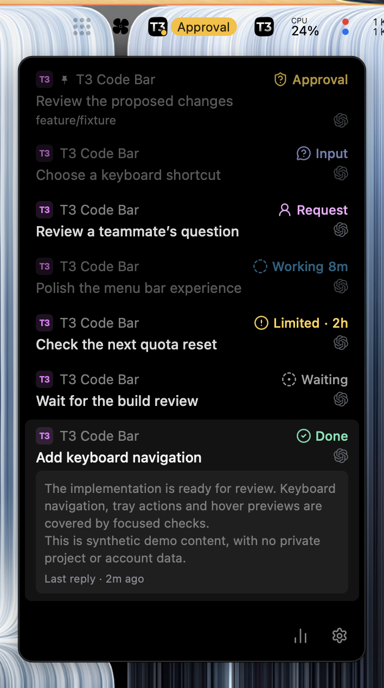
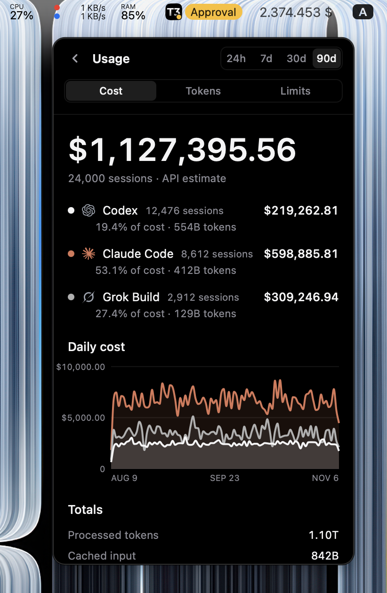

# T3 Code Bar

[](https://github.com/eliophan/t3code-bar/actions/workflows/ci.yml)


[](LICENSE)

Your [T3 Code](https://github.com/pingdotgg/t3code) inbox and usage in the menu bar. Built with Tauri for macOS and Linux.

<p align="center">
  
  
</p>

## Features

- **Threads:** project badges, branches, provider icons, timestamps and attention states.
- **Hover previews:** read the latest assistant reply after 500 ms, enabled by default.
- **Quick actions:** open a thread in T3 Code or your browser, or copy its link.
- **Usage:** Cost, Tokens and Limits, with provider/model breakdowns and charts for 24h, 7d, 30d and 90d. Costs are API estimates.
- **Pairing:** saved reconnect through macOS Keychain or Linux Secret Service.
- **Desktop:** native notifications, persistent settings, macOS menu bar and Linux tray with a window fallback.

## Install on macOS

[Download for Apple Silicon](https://github.com/eliophan/t3code-bar/releases/download/v2.0.0-alpha.1/T3-Code-Bar-2.0.0-alpha.1-darwin-aarch64.app.zip), unzip and move the app to Applications.

Or install with curl:

```sh
curl -fsSL https://eliophan.github.io/t3code-bar/install.sh | bash
```

**Not notarized by Apple.** If macOS blocks the app, try opening it, then go to **System Settings → Privacy & Security → Open Anyway** and confirm. Managed Macs may restrict this option.

## Get started

Requires T3 Code, Node.js 22+, Rust and the native [Tauri prerequisites](https://v2.tauri.app/start/prerequisites/). macOS requires version 14+ and Xcode command line tools. Rust is pinned in `desktop/rust-toolchain.toml`.

```sh
git clone https://github.com/eliophan/t3code-bar.git
cd t3code-bar/desktop
npm ci
npm run tauri -- dev
```

Open T3 Code, generate a pairing key and enter it in the Bar.

## Build

From `desktop/`:

```sh
# macOS
npm run tauri -- build --bundles app

# Linux: deb and AppImage
npm run tauri -- build --config src-tauri/tauri.linux.conf.json
```

Packages are written under `desktop/src-tauri/target/release/bundle/`, unless `CARGO_TARGET_DIR` is configured.

**Alpha 2.0.0-alpha.1.** macOS builds are ad hoc signed and not notarized. Linux integration varies by desktop.

## Privacy

Reads T3 Code data read-only. No telemetry or direct provider API calls. Pairing uses loopback; credentials stay in the OS credential store. Configured builds may check for updates.

## Development

Run `bash scripts/check.sh` from the repository root.

[Development](docs/DEVELOPMENT.md) · [Usage and troubleshooting](docs/USAGE.md) · [Compatibility](docs/COMPATIBILITY.md) · [Release packaging](desktop/RELEASE.md)

## License

[MIT](LICENSE) · [Third-party notices](THIRD_PARTY_NOTICES.md). Independent companion, not affiliated with or endorsed by T3 Tools.
